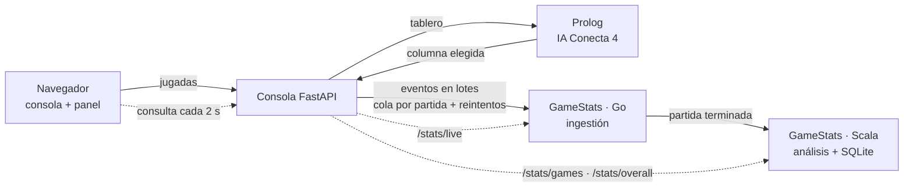

# GameConsole

Consola de videojuegos web con **tres juegos orientados a objetos**, una **IA en Prolog**, envío concurrente de eventos a **GameStats** y un **panel de control en vivo**.

**Curso:** Lenguajes de Programación · Proyecto 2
**Integrantes:** Kendall Andrade · Emerson Ramirez
**Repositorio:** https://github.com/SeishiroGojo/gameconsole
**Estadísticas:** [GameStats](https://github.com/SeishiroGojo/gamestats) (Proyecto 1, ampliado en la v2)
**Video de demostración:** _pegar aquí el enlace público_

---

## Qué hace

| Componente | Tecnología | Qué hace |
|---|---|---|
| Consola web | Python · FastAPI · HTML/JS | Carga los 3 juegos, crea varias instancias a la vez, envía eventos y muestra el panel |
| Juegos | Python (POO) | **Conecta 4** (vs computadora), **2048**, **Buscaminas** |
| Inteligencia | **SWI-Prolog** (servicio HTTP) | Elige la jugada de la computadora con *negamax + poda alfa-beta* |
| Estadísticas | **GameStats** (Go + Scala) | Recibe los eventos, los analiza y entrega las estadísticas que el panel muestra |



La consola **no calcula** ninguna estadística: el panel solo reenvía y muestra lo que responde GameStats.

## Ejecutarlo (3 comandos)

Requisitos: **Docker Desktop** encendido y haber publicado antes GameStats v2 (ver [docs/ci-cd-y-deployment.md](docs/ci-cd-y-deployment.md)).

```powershell
git clone https://github.com/SeishiroGojo/gameconsole.git
cd gameconsole
docker compose up -d --build --wait
```

Abrir **http://localhost:8000**. Para apagar: `docker compose down`.

Probar todo de punta a punta (con el sistema levantado):

```powershell
python scripts/smoketest.py
```

### Desplegar con las imágenes ya publicadas por el CI

```powershell
docker compose -f docker-compose.deploy.yml pull
docker compose -f docker-compose.deploy.yml up -d
```

## Los tres juegos

* **Conecta 4** — tú contra la computadora. Tres dificultades (profundidad de búsqueda 2, 4 y 5). Cada jugada de la computadora la decide Prolog y la pantalla muestra el puntaje, los nodos explorados y la latencia.
* **2048** — flechas del teclado; gana al formar 2048, pierde sin movimientos.
* **Buscaminas** — 9×9, 12×12 o 16×16. La primera jugada nunca es mina; clic derecho (o *modo bandera*) para marcar.

El botón **Demostración → Lanzar** crea partidas automáticas de los tres juegos a la vez (Conecta 4 con Prolog) para ver la concurrencia en vivo en el Panel.

Puedes abrir **varias partidas a la vez** en la misma página y también en **pestañas distintas**: cada una tiene su propio `matchId` (`<juego>-<uuid>`).

## Eventos hacia GameStats

Respetan el contrato de GameStats (`eventId, timestamp, gameId, gameVersion, matchId, playerId, type, action, data`).

| Evento | Cuándo | `data` principal |
|---|---|---|
| `MATCH_STARTED` | al crear la partida | modo, dificultad, jugadores |
| `PLAYER_ACTION` | cada jugada válida de la persona | columna / dirección / casilla |
| `AI_DECISION` | cada decisión de Prolog | estado del tablero, columna, puntaje, nodos, latencia |
| `PLAYER_WON` / `PLAYER_LOST` | al decidirse la partida | jugadas |
| `MATCH_FINISHED` | al terminar o abandonar | resultado, ganador, puntaje, duración |

`gameId`: `connect4`, `game-2048`, `minesweeper`.

## Pruebas

| Qué | Cómo | Cantidad |
|---|---|---|
| IA en Prolog | `swipl -g run_tests -t halt test_ai.pl` (en `prolog/`) | 8 |
| Juegos, envío de eventos y API | `python -m pytest` (en `console/`) | 37 |
| Integración completa | `python scripts/smoketest.py` | 9 comprobaciones |

El CI de GitHub ejecuta todo esto en cada *push* y, si pasa, publica las imágenes en GHCR.

## Documentación

* [Decisiones técnicas](docs/decisiones-tecnicas.md) — POO, Prolog, envío concurrente, panel.
* [CI/CD y deployment](docs/ci-cd-y-deployment.md) — pasos de instalación, ejecución y despliegue.
* [Guion del video](docs/guion-video.md)
