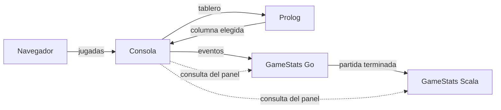

# GameConsole

Consola de videojuegos web con tres juegos hechos con programación orientada a objetos, una IA escrita en Prolog, envío concurrente de eventos a GameStats y un panel de control que muestra las estadísticas en vivo.

**Curso:** Lenguajes de Programación, Proyecto 2
**Integrantes:** Kendall Andrade y Emerson Ramirez
**Repositorios:** [gameconsole](https://github.com/SeishiroGojo/gameconsole) y [gamestats](https://github.com/SeishiroGojo/gamestats)
**Video de demostración:** https://youtu.be/vYrueaqttVg

## Cómo está organizado

| Componente | Tecnología | Función |
|---|---|---|
| Consola web | Python (FastAPI) y HTML/JS | Carga los juegos, maneja varias partidas a la vez, envía eventos y muestra el panel |
| Juegos | Python, orientado a objetos | Conecta 4 (contra la computadora), 2048 y Buscaminas |
| Inteligencia artificial | SWI-Prolog como servicio HTTP | Decide las jugadas de la computadora en Conecta 4 |
| Estadísticas | GameStats (Go y Scala), proyecto 1 | Recibe los eventos, los analiza y entrega las estadísticas |



La consola no calcula estadísticas: el panel pide los datos a GameStats y los muestra tal cual.

## Cómo ejecutarlo

Se necesita **Docker Desktop** y los dos proyectos en carpetas hermanas, porque GameStats se construye desde su código:

```
una-carpeta/
├── gameconsole/
└── gamestats/
```

```powershell
git clone https://github.com/SeishiroGojo/gamestats.git
git clone https://github.com/SeishiroGojo/gameconsole.git
cd gameconsole
docker compose up -d --build --wait
```

La primera vez tarda unos minutos (compila Scala). Después se abre **http://localhost:8000**. Para apagar todo: `docker compose down`.

Prueba de punta a punta (necesita Python 3, con el sistema encendido):

```powershell
python scripts/smoketest.py
```

Debe terminar con `RESULTADO: todo correcto`.

## Los juegos

- **Conecta 4:** la persona juega contra la computadora, con tres dificultades. Cada jugada de la computadora la decide Prolog, y la pantalla muestra el puntaje, los nodos explorados y el tiempo que tardó.
- **2048:** se juega con las flechas del teclado.
- **Buscaminas:** tres tamaños de tablero. La primera casilla que se descubre nunca es mina.

Se pueden abrir varias partidas a la vez en la misma página o en pestañas distintas. Cada partida tiene su propio identificador (`<juego>-<uuid>`). El botón **Demostración** lanza partidas automáticas de los tres juegos para ver la concurrencia en el panel.

## Eventos enviados a GameStats

Siguen el contrato de GameStats (`eventId`, `timestamp`, `gameId`, `gameVersion`, `matchId`, `playerId`, `type`, `action`, `data`).

| Evento | Cuándo se envía |
|---|---|
| `MATCH_STARTED` | al crear la partida |
| `PLAYER_ACTION` | en cada jugada válida de la persona |
| `AI_DECISION` | en cada decisión de Prolog (con el estado, la columna, el puntaje y los nodos) |
| `PLAYER_WON` / `PLAYER_LOST` | cuando se decide la partida |
| `MATCH_FINISHED` | al terminar o abandonar (resultado, puntaje, duración) |

Los `gameId` son `connect4`, `game-2048` y `minesweeper`.

## Panel de control

Consulta tres endpoints de GameStats cada 2 segundos:

- `GET /stats/live` (Go): partidas iniciadas, en curso y terminadas por juego.
- `GET /stats/games` (Scala): estadísticas agregadas por juego.
- `GET /stats/overall` (Scala): estadísticas generales.

Para esto se amplió GameStats (ver [docs/gameconsole-integration.md](https://github.com/SeishiroGojo/gamestats/blob/main/docs/gameconsole-integration.md) en ese repositorio).

## Pruebas

| Qué | Comando | Cantidad |
|---|---|---|
| IA en Prolog | `swipl -g run_tests -t halt test_ai.pl` (en `prolog/`) | 8 |
| Juegos, envío de eventos y API | `python -m pytest` (en `console/`, después de `pip install -r requirements-dev.txt`) | 39 |
| Integración completa | `python scripts/smoketest.py` | 9 comprobaciones |

## Docker, CI/CD y deployment

- Cada componente tiene su Dockerfile y `docker-compose.yml` levanta todo el sistema.
- El pipeline está en `.github/workflows/ci.yml`: pruebas de Prolog y de la consola, integración con Docker Compose y prueba de humo, publicación de imágenes en GHCR y un despliegue opcional por SSH.
- `docker-compose.deploy.yml` levanta el sistema usando las imágenes publicadas por el pipeline.

**Estado del CI al momento de la entrega:** GitHub bloqueó la cuenta de uno de los integrantes por un problema de facturación y los jobs no llegaron a iniciar ("The job was not started because your account is locked due to a billing issue", [ejecución](https://github.com/SeishiroGojo/gamestats/actions/runs/44696631589)). Por eso la última ejecución del pipeline no pudo correr, y la forma de ejecución por defecto es construir todo localmente con `docker compose up --build`. Las ejecuciones anteriores de GameStats, antes del bloqueo, terminaron en verde. Cuando el pipeline pueda correr, publicará las imágenes y `docker-compose.deploy.yml` quedará disponible tal como está.

## Documentación

- [Decisiones técnicas](docs/decisiones-tecnicas.md): orientación a objetos, Prolog, envío concurrente de eventos y panel.
- [Instalación y deployment](docs/instalacion-y-deployment.md): pasos detallados y solución de problemas.
